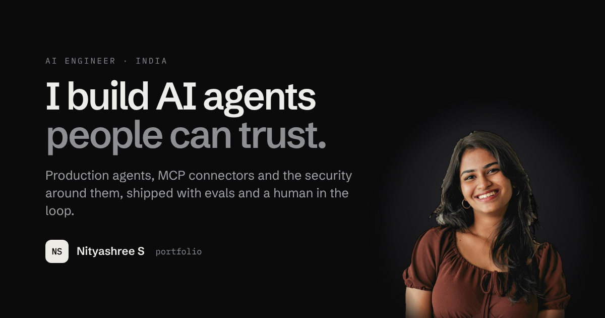

# nityashree.in

[](https://nityashree.in)

My portfolio: three case studies on building, connecting and securing AI agents in production, plus a little about me.

**Live:** https://nityashree.in

## What's on it

- **Home:**
  - who I am
  - three case studies, each led by its outcome
  - four side projects you can try live, each with its code
  - how I work
  - my path, as a hand-drawn trail
  - a desk of things I do off the clock
  - an envelope to write to me
- **Case 01, agent platform:** the engine, studio and gateways behind company-wide AI agents, and how I keep them running.
- **Case 02, MCP connections:** connectors that let agents use real apps with each person's own access, never a shared key.
- **Case 03, security:** every layer closed by default, and every fix proven by replaying the attack.

Screens on the site are illustrations of how the work behaves, not screenshots of company systems. Internal names and metrics are left out on purpose.

## How it's built

I don't hand-write code. I direct AI coding agents, review every change, test it and own what ships.

- [Astro](https://astro.build), a static site with no framework runtime.
- Hand-drawn line illustrations as inline SVG.
- Animation uses only transform and opacity, plays once and stops off screen. It respects reduced motion.
- A performance guard: `npm run perf` builds the site and plays a rough session on the home desk (ten quick clicks, hovering everything, scrolling while notes animate) in Chromium at 1440x900, DPR 2, with the CPU slowed 4x. It fails if the 95th-percentile frame is over 20ms or any frame is over 50ms. **Run `npm run perf` before every deploy.** `npm run perf:report` writes the full lab report (home desk, My corner and the hero at 4x and 6x, with devtools traces) to `perf-report/`.
- Works in Safari 14+, Chrome/Edge 100+ and Firefox 100+, from phones up to 4K screens.
- A small command menu (Cmd+K / Ctrl+K, "/" or the search button in the nav) jumps to each case, the side projects, the resume, email, GitHub and LinkedIn. Vanilla JS, keyboard and screen-reader friendly.
- Every page also has a plain markdown version for AI agents: [`/llms.txt`](https://nityashree.in/llms.txt).

## Run it locally

```bash
npm install
npm run dev      # http://localhost:4321
npm run build    # static site in dist/
npm run perf     # build, then the performance guard (run before every deploy)
                 # first time on a machine: npx playwright install chromium
```

The resume PDF is built from `resume/resume.html` with `node resume/make-pdf.mjs`.

## Repo map

| Path | What |
|---|---|
| `src/pages/` | Home, the three case studies and the 404 |
| `src/components/` | Trail, desk, phone, laptop, envelope links and other pieces |
| `src/data/` | All page copy, kept apart from layout |
| `src/styles/global.css` | Styles and the motion and colour tokens |
| `src/lib/markdown.ts` | The markdown and `llms.txt` versions of each page |
| `scripts/perf.mjs` | The performance guard behind `npm run perf` |
| `DEPLOY.md` | How the site deploys on Vercel |
