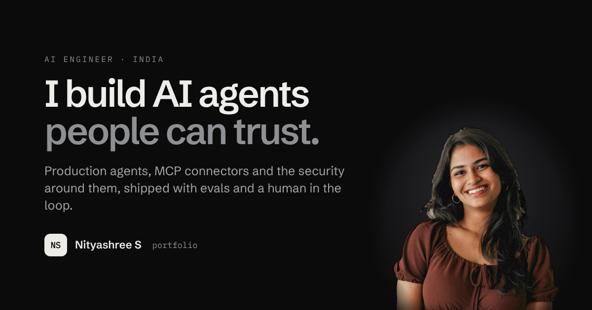

# nityashree.vercel.app

[](https://nityashree.vercel.app)

My portfolio: three case studies on building, connecting and securing AI agents in production, plus a little about me.

**Live:** https://nityashree.vercel.app

## What's on it

- **Home:**
  - who I am
  - three case studies, each led by its outcome
  - how I work
  - my path, as a hand-drawn trail
  - a desk of things I do off the clock
  - an envelope to write to me
- **Case 01, agent platform:** the engine, studio and gateways behind company-wide AI agents, and how I keep them running.
- **Case 02, MCP connections:** connectors that let agents use real apps with each person's own access, never a shared key.
- **Case 03, security:** every layer closed by default, and every fix proven by replaying the attack.

Screens on the site are illustrations of how the work behaves, not screenshots of company systems. Internal names and metrics are left out on purpose.

## How it's built

I don't hand-write code. I direct AI coding agents, review every change, test it and own what ships. That's why the commits carry a co-author line.

- [Astro](https://astro.build), a static site with no framework runtime.
- Hand-drawn line illustrations as inline SVG.
- Animation uses only transform and opacity, plays once and stops off screen. It respects reduced motion.
- Works in Safari 14+, Chrome/Edge 100+ and Firefox 100+, from phones up to 4K screens.
- Every page also has a plain markdown version for AI agents: [`/llms.txt`](https://nityashree.vercel.app/llms.txt).

## Run it locally

```bash
npm install
npm run dev      # http://localhost:4321
npm run build    # static site in dist/
```

The resume PDF is built from `resume/resume.html` with `node resume/make-pdf.mjs`.

## Repo map

| Path | What |
|---|---|
| `src/pages/` | Home, the three case studies and the 404 |
| `src/components/` | Trail, desk, phone, laptop, envelope links and other pieces |
| `src/data/` | All page copy, kept apart from layout |
| `src/styles/global.css` | Styles and the motion and colour tokens |
| `src/lib/markdown.ts` | The markdown and `llms.txt` versions of each page |
| `DEPLOY.md` | How the site deploys on Vercel |
